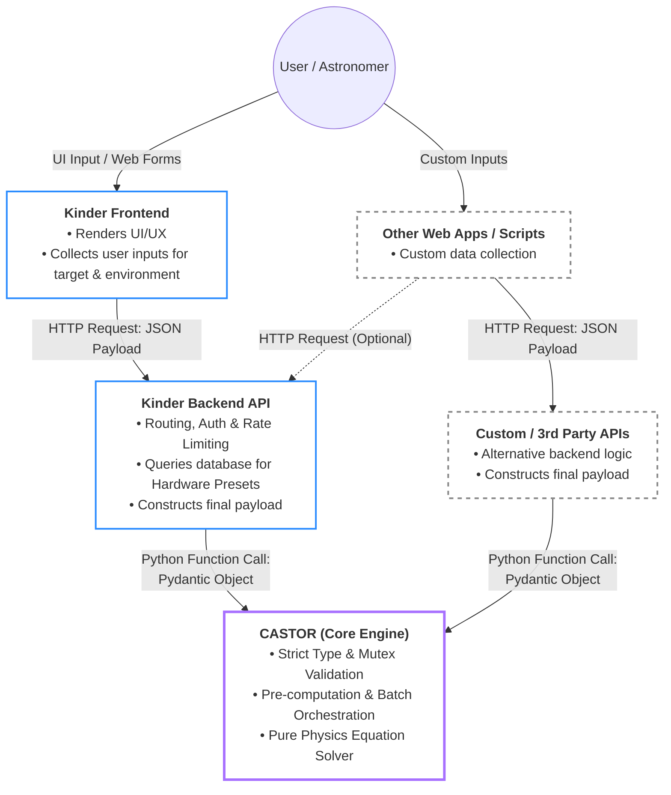
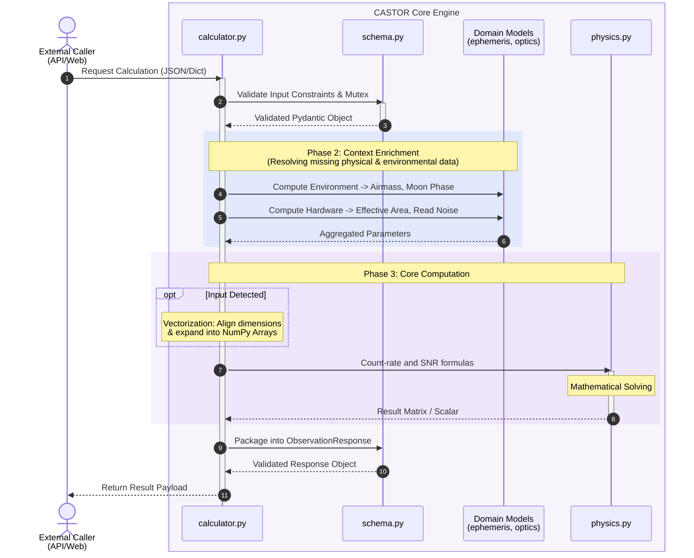
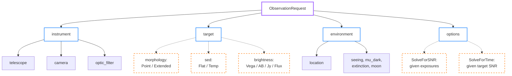

# Architecture

## 1. System Overview

### 1.1 Product Identity

The CASTOR core (`src/castor/`) calculates exposure times and signal-to-noise
ratios for optical observations. It validates complete observation requests and
applies the optical, atmospheric, and detector model described in the ATBD.
The repository also includes a CLI and GUI; this document covers the core.

> This document covers the core engine (`src/castor/`) only. Three things are built on top of it and documented separately: **CASTOR GUI** (`src/castorGUI/`, [architecture](gui_architecture.md)), the **command line** (`src/castorCLI/`, [reference](cli.md)), and the **preset catalogue** both of them read ([presets](presets.md)).
>
> How good the engine's answers actually are is a different question from how it is built, and has its own home: [`validation/`](../validation/VALIDATION_REPORT.md) measures CASTOR against other observatories' calculators and real photometry, and [`validation/QUESTIONS.md`](../validation/QUESTIONS.md) lists what it still does not know.

### 1.2 Core Value

Hardware parameters enter through the request schema rather than an internal
equipment database. A caller can provide a supported telescope, camera, filter,
target, and observing conditions for a single calculation or a time series.
Accuracy still depends on the quality of those inputs and on the model's
documented limits.

### 1.3 System Context & Boundary

To maintain the purity and high performance of the core engine, a strict division of responsibilities and a clear data transformation pipeline are established. While CASTOR is natively integrated with the [Kinder](https://kinder.astro.ncu.edu.tw) ecosystem, its decoupled architecture allows it to be invoked by any external application:



#### In Scope for CASTOR

##### A. Core Computational Engine

* **Two calculation modes:** Calculating SNR from a specified exposure count, or solving for the count that reaches a target SNR. The solve accounts for the correlated background-flatness floor and reports a target above that floor's ceiling as unreachable.
* **Metric Generation:** Returning source and sky count rates, pixel scale, SNR, and a saturation flag. The caller can derive total integration time from frame count and single-frame duration; readout overhead is not included.

##### B. Data Contract & Batch Orchestration

* **Strict Validation:** Enforcing physical boundaries (e.g., $0.0-1.0$ limits) and logical mutual exclusivity (time vs. SNR) via Pydantic schemas.
* **Polymorphic Time-Domain Expansion:** Ingesting continuous time-range contracts (start, end, step) and automatically expanding them into high-resolution discrete arrays.
* **Vectorized Processing:** Using NumPy arrays to evaluate the same formulas at multiple timestamps. Work and memory grow with the number of samples.

##### C. Astronomical & Environmental Modeling

* **Target Morphologies:** Supporting point and extended sources. The schema accepts an SED type, but the current calculation treats every target as spectrally flat across the filter; see the ATBD §5.4.
* **Dynamic Ephemeris & Background:** Automatically computing instantaneous Airmass, Moon phase, Moon position, and dynamic sky background contributions based on target coordinates and observation timestamps.
* **Atmospheric Corrections:** Applying atmospheric extinction and Point Spread Function (PSF) enclosed-flux modeling.

##### D. Hardware Optics & Sensor Modeling

* **Optical Train Aggregation:** Calculating effective light-gathering area (accounting for obstruction) and total system optical throughput.
* **Sensor Parameters:** Accepting pixel pitch, quantum efficiency, dark current,
  read noise, and full-well capacity. Binning modes, amplifier selection, and
  readout overhead are not modelled.

#### Out of Scope for CASTOR

To maintain its identity as a lightweight, high-performance computational kernel, CASTOR intentionally delegates the following responsibilities to the parent ecosystem (e.g., [Kinder](https://kinder.astro.ncu.edu.tw)):

##### A. Data Persistence & State Management

* **No Hardware Databases:** It does not store default parameter presets for specific observatories, telescopes, or filter zero-points.
* **Stateless Execution:** It does not maintain historical user calculation logs, session states, or user profiles. Every calculation is entirely self-contained.

##### B. Network & Infrastructure

* **No Web Serving:** It does not handle inbound HTTP requests, serve web traffic, or provide API routing (e.g., FastAPI/Flask instances).
* **No Security Middleware:** It does not manage API authentication (OAuth/JWT), authorization, database connection pooling, or rate limiting.

##### C. User Interface & Visualization

* **No Frontend Components:** It does not generate HTML, CSS, JavaScript, or interactive web forms.
* **No Graphical Plotting:** It outputs pure mathematical arrays and scalar metrics; it does not render visibility curves or data plots (e.g., Matplotlib/Plotly figures).

> **Note on `src/castorGUI/`:** This boundary describes `src/castor/` only. The repository also ships **CASTOR GUI**, a separate, independently-scoped product that owns exactly the UI/visualization responsibilities this engine deliberately excludes. It is not a special caller — it imports `castor.calculator` / `castor.batch_calculator` / `castor.schema` as a plain Python library and calls them in-process, the same contract any external caller like Kinder would use. See [CASTOR GUI Architecture](gui_architecture.md) for its product identity, scope, and component design.

##### D. High-Level Scheduling & Operations

* **No Queue Optimization:** While optimized to *support* schedulers, CASTOR itself does not decide the optimal observation order for targets or generate automated telescope operation queues.
* **No Hardware Constraint Checking:** It does not evaluate telescope mechanical pointing limits (e.g., dome slit collisions or altitude limits) or integrate with real-time weather forecasts.

## 2. Component Architecture

The repository holds the engine and the three things built on it. Only the first
is this document's subject; the boundary between them is the point.

```text
src/
├── castor/             # the engine — this document
│   ├── __init__.py         # Package Entry Point
│   ├── calculator.py       # Single-Request Orchestrator
│   ├── batch_calculator.py # Time-Series Batch Orchestrator
│   ├── schema.py           # Data Contracts & Mutex Validation
│   ├── moon.py             # Astropy-Based Ephemeris, Lunar & Zodiacal Sky Brightness
│   └── physics.py          # Pure Mathematical & Optical Physics Engine
├── castorCLI/          # command line + the preset reader  -> cli.md, presets.md
└── castorGUI/          # browser and desktop UI            -> gui_architecture.md
```

`castorCLI/presets.py` deserves a note on why it sits outside the engine: hardware
presets are deliberately out of scope for `castor/` (§1.3), and a host with its own
hardware database — Kinder is one — has no use for a reader of this repository's
JSON file. Putting it in the engine would make it dead weight there.

### Module Responsibilities

* **`calculator.py`:** The system's traffic controller for single-request calculations. It receives a validated `ObservationRequest`, calls `moon.py` for airmass/lunar geometry and `physics.py` for the optical and count-rate formulas, and packages the final `ObservationResponse`.

* **`batch_calculator.py`:** Expands a `TimeSeriesEnvironment` (start/end/step) into discrete timestamps and vectorizes the same physics pipeline across the resulting NumPy arrays, returning a `BatchObservationResponse`.

* **`schema.py`:** Defines Pydantic models to block invalid data at the door. It enforces physical boundaries (e.g., transmission rates strictly between $0.0$ and $1.0$) and logical mutual exclusivity (e.g., requiring either exposure time or target SNR, but not both).

* **`moon.py`:** Handles dynamic variables related to time and space using Astropy (target/moon ephemeris, airmass, the Krisciunas & Schaefer 1991 lunar sky-brightness model, and a pointing-dependent zodiacal term). Unlike the rest of the engine, this module depends on an external astronomy library rather than pure local math. Its name understates it — the module owns the whole sky-brightness model, of which the moon is one of three components.

* **`physics.py`:** The computational core. Combines the optical/hardware conversions (effective area, total throughput, pixel scale, aperture geometry) with the count-rate and SNR formulas. It contains no web schemas or API logic — only pure numerical functions operating on scalars or NumPy arrays.

Error handling currently relies on Pydantic's `ValidationError` at the schema boundary and plain `ValueError` for physics-domain violations raised inside `calculator.py` / `physics.py` (e.g. an unrecognized morphology or calculation-option type). There is no dedicated exception hierarchy yet — see §6.

## 3. Design Principles

### 3.1 Separation of Concerns

CASTOR strictly isolates physical phenomena from software execution logic. The architecture is built around four distinct domain pillars: Instrument, Target, Environment, and Strategy. By decoupling static hardware definitions from dynamic atmospheric conditions and human-driven observation strategies, the core engine remains purely mathematical. Internally the same separation holds by module: `schema.py` handles I/O and validation, `moon.py` enriches a request with everything that depends on when and where it is pointed, `physics.py` is dedicated exclusively to mathematical solving, and the two orchestrators own sequencing and nothing else.

### 3.2 Contract-Driven & Fail-Fast

The system treats the calculation boundary as a strict contract. Utilizing Pydantic models, CASTOR validates all incoming requests at the very edge of the application (Phase 1: Ingress). It enforces three levels of validation:

1. **Physical Boundaries**: Mathematical limits are applied directly to custom types (e.g., optical transmissions between $0.0$ and $1.0$, Declination between $-90.0$ and $+90.0$).
2. **Logical Mutual Exclusivity**: Enforces exact strategies (e.g., requesting both `exposure_time` and `target_snr` simultaneously is forbidden).
3. **Strict Model Rejection**: All models inherit from a `StrictModel` (`extra="forbid"`), ensuring that any request containing unknown, misspelled, or garbage parameters is immediately rejected.

### 3.3 Statelessness

CASTOR does not maintain user sessions, calculation logs, or a hardware
database. Every `ObservationRequest` carries the required instrument, target,
and environment parameters. The batch path evaluates a series of timestamps
without storing prior results.

### 3.4 Analytical Determinism

`physics.py` uses algebraic formulas for count rates and SNR. The
solve-for-time formula inverts the stacked SNR including the background-flatness
term, which does not average down between exposures; a target at or above the
resulting SNR ceiling is reported as unreachable rather than given a frame count
(ATBD §4.3.3). Remaining model limits are in
[`validation/QUESTIONS.md`](../validation/QUESTIONS.md). Batch cost also includes
ephemeris calculations at each requested timestamp. Treat the output as a model
estimate, not a guarantee for telescope scheduling.

## 4. Data Flow & Lifecycle

CASTOR validates each request, derives geometry and count rates from the
supplied parameters, then calculates SNR or the required exposure count. The
core does not fill in missing hardware specifications; preset resolution is a
separate responsibility of the CLI and GUI.



### 4.1 Lifecycle Phases Breakdown

#### Phase 1: Ingress & Validation

* **Input**: A JSON payload or Python dictionary containing the user's observation parameters and hardware configurations.
* **Action**: The `schema.py` module uses Pydantic to strictly validate the incoming data against two main constraints:
  1. **Physical Limits**: Requires positive exposure times and transmission
     fractions between 0.0 and 1.0, inclusive.
  2. **Mutual Exclusivity**: The `options.type` discriminator selects either
     `solve_snr` with `num_exposures` or `solve_time` with `target_snr`.
* **Output**: A validated Pydantic object (`ObservationRequest`). If any check fails, the system immediately rejects the request with a validation error to protect the core engine.

#### Phase 2: Context Enrichment

* **Input**: The validated `ObservationRequest` object.
* **Action**: Derives airmass, target and sky rates, and other intermediate
  quantities from the supplied request. Missing required instrument fields
  were rejected during validation.
* **Output**: Intermediate quantities ready for the SNR formulas.

#### Phase 3: Core Computation

* **Input**: The enriched and aggregated parameter set.
* **Action**:
  1. **Optional Vectorization**: A batch request expands its time range into
     timestamps and evaluates the formulas over NumPy arrays.
  2. **Mathematical Solving**: `physics.py` applies the count-rate and noise
     formulas to scalar values or NumPy arrays. It has no network or database
     dependencies.
* **Output**: SNR values and, in solve-for-time mode, required exposure counts.

#### Phase 4: Egress

* **Input**: The raw numerical outputs from the physics engine.
* **Action**: The orchestrator maps the raw numbers into the final structured output layout. During this step, it also performs hardware boundary checks, such as verifying if the signal level exceeds the sensor's full-well capacity to flag pixel saturation (`is_saturated`).
* **Output**: A validated `ObservationResponse` object returned to the caller.

## 5. Data Contracts & Schema

CASTOR uses Pydantic models for input validation. The request and response
fields, types, and boundaries are defined in
[`src/castor/schema.py`](../src/castor/schema.py); `castor schema` prints the
request as JSON Schema. Many field descriptions include units and ATBD symbols.
The equations are in the [ATBD](ATBD.md).

### 5.1 Request Schema

To ensure maintainability and preserve the purity of the underlying physics calculations, the CASTOR engine structures its incoming data payload (`ObservationRequest`) using a Domain-Driven Design approach. Rather than flattening all parameters into a single monolithic object, the request is strictly segregated into four independent pillars.

This modularity fully decouples the physical realities of the observatory from the software-level execution logic, allowing the core physics solver to maintain stateless, high-performance execution.

* **Instrument Profile (`instrument`)**: Defines the static hardware components responsible for capturing light. To maximize reusability, it is further subdivided into the telescope's optical system, the camera's sensor electronics, and the passband filter. Notably, the filter schema is designated as `optic_filter` to prevent shadowing Python's built-in `filter` function.
* **Target Profile (`target`)**: Defines the intrinsic physical properties of the celestial source. To prevent users from accidentally submitting conflicting data (such as providing both `"apparent magnitude"` for a star and `"surface brightness"` for a galaxy simultaneously), we avoid using a single, monolithic structure. Instead, the target relies on a specific type tag (e.g., `"point"` or `"extended"`) to seamlessly switch to the appropriate data format. This ensures that invalid data combinations are immediately blocked at the very edge of the system. Once the data reaches the core physics engine, the code can use pattern matching directly on the target type—routing point sources to PSF-based flux equations and extended sources to surface brightness formulas. This approach completely eliminates the need for complex and hard-to-maintain nested `if-else` branching within the core engine.
* **Environment Condition (`environment`)**: Defines the atmospheric and situational context that alters the target's light before it reaches the telescope — the seeing budget, the dark sky baseline, the extinction coefficient, the moon switch, and the observatory's own position on the Earth. Unlike the other three, this pillar is a single flat model rather than a set of alternatives: there is only one kind of sky, and every field applies to it.
* **Calculation Options (`options`)**: Acts as the software control interface. It separates human-driven observation strategies and runtime overrides—such as toggling between target SNR and exposure time calculations—from the objective physical parameters.

A solid edge means the part is always present. A dashed edge means the caller
picks exactly one of the alternatives, tagged by a `type` discriminator, so an
invalid combination cannot be expressed rather than being caught later.



### 5.2 Response Schema

The single-request result is an `ObservationResponse`; the time-series result
is a `BatchObservationResponse`.

The response strictly avoids UI-specific formatting, presentation layers, or plotting objects, focusing purely on returning raw mathematical value and physical metrics. The output is logically grouped into the following categories:

* **Core metrics:** Single-frame and total SNR, and in solve-for-time mode the required frame count, the flatness SNR ceiling, and whether the target is reachable. The result also includes saturation and noise-crossover times.
* **Rates and diagnostics:** Source and sky electron rates, effective area, pixel scale, throughput, aperture geometry, and related quantities.
* **Flags:** Saturation and model warnings. Elapsed observation time, including readout overhead, is not returned.

## 6. Open work

Unresolved measurements, model limits, and future work are tracked in
[`validation/QUESTIONS.md`](../validation/QUESTIONS.md). This architecture
document describes the implemented system.
